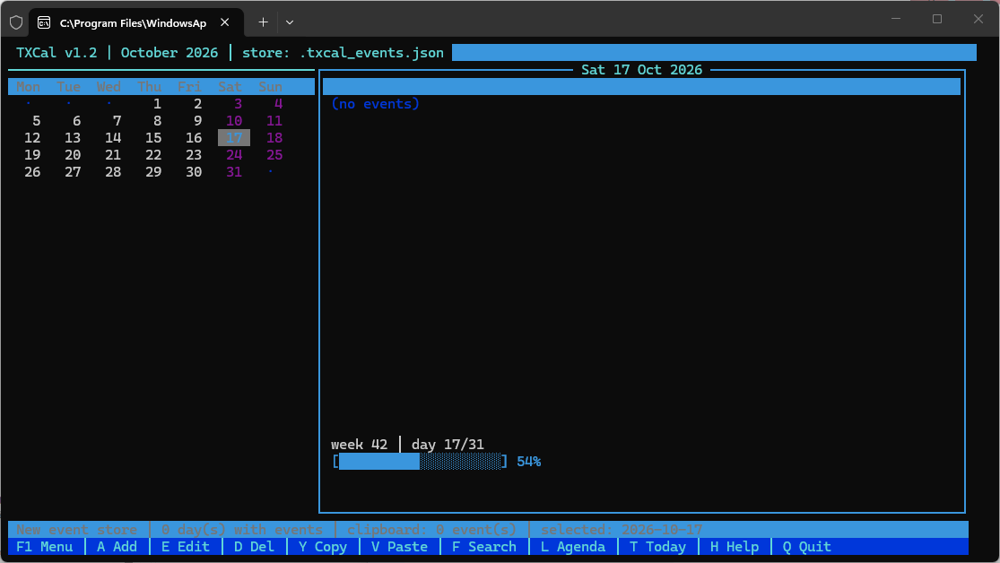

# TX-Cal (TerminalX Calendar)

<p align="center">
  
</p>

<p align="center">
  <a href="https://www.python.org/"></a>
  <a href="#"></a>
  <a href="#"></a>
  <a href="#"></a>
  <a href="LICENSE"></a>
</p>

---

## 📌 Overview

**TX-Cal** is a lightweight, responsive curses-based Terminal User Interface (TUI) calendar application. Designed for fast navigation and distraction-free productivity, it features an interactive month grid, event scheduling, priority categorization, clipboard operations, agenda views, and data import/export.

---

## ✨ Features

- 📅 **Interactive Month View** – Seamless month grid with day-by-day cursor navigation, weekend highlighting, and distinct marks for days with scheduled events.
- 📝 **Event Management** – Easily add, edit, delete, and move events between dates.
- 📋 **Day Clipboard Operations** – Copy, cut, and paste all events belonging to a day across different dates.
- 🔍 **Full-Text Search & Agenda** – Instant search across all events with jump-to-result, plus a chronological upcoming agenda view.
- 🏷️ **Smart Priority Classification** – Automatic detection and color coding of priorities (`High`, `Medium`, `Low`) based on tags like `[HIGH]`, `!H`, `[MEDIUM]`, etc.
- 📊 **Statistics & Overview** – View aggregate statistics including total events, busiest days, and upcoming schedule distribution.
- 🔄 **Data Portability** – Import and export calendar data via standard CSV and structured JSON.
- 🌐 **Robust Terminal Support** – Crisp Unicode box-drawing with automatic ASCII fallbacks for legacy terminal environments.

---

## ⌨️ Keyboard Shortcuts

### General & Navigation

| Key | Action |
| :--- | :--- |
| `↑` / `↓` / `←` / `→` | Navigate days across weeks and days |
| `Page Up` / `-` / `p` | Previous month |
| `Page Down` / `+` / `n` | Next month |
| `Home` / `End` | Move to start / end of the month |
| `t` | Jump to today's date |
| `g` | Jump to specific date (`YYYY-MM-DD` or `YYYY-MM`) |
| `F1` | Open Interactive Menu |
| `h` | Show Help Dialog |
| `Ctrl+Q` | Quit Application |

### Event & Clipboard Actions

| Key | Action |
| :--- | :--- |
| `a` | Add new event to selected date |
| `e` | Edit selected event |
| `d` | Delete selected event |
| `m` | Move event to another date |
| `c` | Clear all events on the selected date |
| `y` | Copy events of the current day to clipboard |
| `w` | Cut events of the current day to clipboard |
| `v` | Paste events from clipboard to current day |

### Search, Views & Data

| Key | Action |
| :--- | :--- |
| `f` / `Ctrl+F` | Search events / Jump to next match |
| `l` | Show Agenda view (upcoming events) |
| `r` | Show Priority view |
| `s` | View Calendar Statistics |
| `x` | Export calendar events to CSV |
| `i` | Import calendar events from CSV |

---

## 🚀 Installation & Requirements

### Prerequisites

- **Python 3.10+**
- Standard Python libraries (`curses`, `calendar`, `json`, `csv`, `datetime`, `pathlib`)

### Windows Users

The standard `curses` module is included on Linux/macOS. For Windows, install `windows-curses`:

```bash
pip install windows-curses
```

---

## 💻 Usage

Run TX-Cal directly with Python:

```bash
python TX-Cal_v1.2.py
```

### Custom Data Store

By default, events are stored in `~/.txcal_events.json`. You can specify a custom JSON file path either via an argument or an environment variable:

```bash
# Pass custom path as argument:
python TX-Cal_v1.2.py /path/to/my_calendar.json

# Or set via environment variable:
export TXCAL_STORE="/path/to/my_calendar.json"
python TX-Cal_v1.2.py
```

---

## 💾 Data Format

Events are persisted in human-readable JSON format:

```json
{
  "2026-10-17": [
    "[HIGH] Deploy v1.2 release to production",
    "Team sync meeting at 14:00"
  ]
}
```

---

## 👨‍💻 Author

- **Developer:** Sebastian Januchowski
- **Organization:** polsoft.ITS™ Group
- **Email:** [polsoft.its@mail.com](mailto:polsoft.its@mail.com)
- **GitHub:** [@polsoft-it](https://github.com/polsoft-it)

---

## 📄 License

This project is licensed under the [MIT License](LICENSE).
